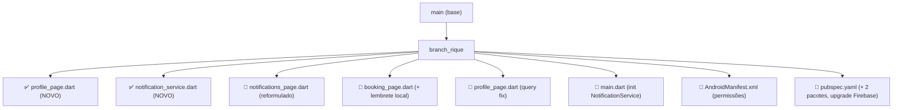

# 📊 Comparativo: `main` → `branch_rique`
### Barbú Barbearia — Relatório de Mudanças

> **Período:** Junho 2026  
> **Branch base:** `main` (SantosGAlves)  
> **Branch de trabalho:** `branch_rique` (Henrique)  
> **Escopo:** Funcionalidades de perfil, notificações, lembretes locais e correções de bugs

---

## Visão Geral

````carousel
| Métrica | `main` | `branch_rique` |
|---|---|---|
| Arquivos Dart | 12 | **15** (+3 novos) |
| Dependências | 6 pacotes | **8 pacotes** (+2) |
| Telas funcionais | 5 | **6** (+Perfil) |
| Sistema de notificações | ❌ Estático (hardcoded) | ✅ Firestore em tempo real |
| Lembretes automáticos | ❌ Inexistente | ✅ Notificação local agendada |
| Permissões Android | 0 explícitas | **4** (notifications, alarm, boot) |
| Bugs críticos conhecidos | 3 | **0** |

<!-- slide -->


````

---

## 1. Arquivos Novos

### 🆕 `lib/screens/profile/profile_page.dart`

**Não existia no `main`.** Página completa de perfil do usuário criada do zero.

**O que faz:**
- Carrega dados do usuário do Firestore (`users/{uid}`)
- Exibe próximos agendamentos em tempo real via `StreamBuilder`
- Links de contato funcionais: WhatsApp, Instagram, Google Maps
- Horário de funcionamento da barbearia
- Botão de logout com confirmação
- Navegação para Histórico e Avisos

```diff
+ lib/screens/profile/profile_page.dart   (~620 linhas, criado do zero)
```

---

### 🆕 `lib/services/notification_service.dart`

**Não existia no `main`.** Serviço centralizado para notificações locais agendadas no dispositivo.

**O que faz:**
- Inicializa `flutter_local_notifications` com suporte Android e iOS
- Configura canal de notificação Android (`barbu_channel`)
- Solicita permissões em Android 13+ e iOS automaticamente
- Agenda alarme local X minutos antes do agendamento
- Cancela notificações quando agendamento é cancelado
- Ignora silenciosamente na web (sem erros)

```dart
// Antes (main): inexistente

// Depois (branch_rique):
await NotificationService.scheduleBookingReminder(
  bookingId: docRef.id,
  service: 'Corte Padrão',
  barber: 'Felipe',
  appointmentDateTime: DateTime(2026, 6, 15, 14, 0),
  minutesBefore: 60, // dispara às 13:00
);
```

---

## 2. Arquivos Modificados

### 🔧 `lib/screens/notifications/notifications_page.dart`

````carousel
**`main` — Estado anterior:**

```dart
// Tela completamente estática: lista hardcoded, sem Firebase
class NotificationsPage extends StatelessWidget {
  @override
  Widget build(BuildContext context) {
    // ...
    SliverList(
      delegate: SliverChildBuilderDelegate(
        (context, index) => _buildAvisoCard(avisos[index]),
        childCount: avisos.length,  // ← lista fixa no código
      ),
    ),
    // Sem conexão alguma com Firebase
  }
}
```

<!-- slide -->

**`branch_rique` — Estado atual:**

```dart
// StreamBuilder lendo Firestore em tempo real
StreamBuilder<QuerySnapshot>(
  stream: FirebaseFirestore.instance
      .collection('notifications')
      .doc(user.uid)
      .collection('items')
      .orderBy('createdAt', descending: true)
      .limit(20)
      .snapshots(),      // ← listener em tempo real
  builder: (context, snapshot) {
    // Trata loading, erro e estado vazio
    // Renderiza cards dinamicamente por tipo (booking/promo/info)
  },
),
```

**+ Botão "Testar"** para demo de notificação sem precisar agendar.
````

---

### 🔧 `lib/screens/bookings/booking_page.dart`

````carousel
**`main` — Salvava apenas 1 coleção:**

```dart
Future<void> _saveBooking() async {
  // Salvava booking no Firestore
  await FirebaseFirestore.instance.collection('bookings').add({...});

  // ← Sem notificação
  // ← Sem lembrete local
  _showSuccessDialog();
}
```

<!-- slide -->

**`branch_rique` — 3 ações ao confirmar:**

```dart
Future<void> _saveBooking() async {
  // 1. Salva booking e guarda o ID gerado
  final docRef = await FirebaseFirestore.instance
      .collection('bookings').add({...});

  // 2. Grava notificação in-app no Firestore
  await FirebaseFirestore.instance
      .collection('notifications')
      .doc(user.uid)
      .collection('items')
      .add({
        'type': 'booking',
        'titulo': 'Agendamento Confirmado! ✂️',
        'msg': '$service com $barber em $date às $time.',
        'lida': false,
        'createdAt': FieldValue.serverTimestamp(),
      });

  // 3. Agenda lembrete local 60 min antes (Android/iOS)
  await NotificationService.scheduleBookingReminder(
    bookingId: docRef.id,
    service: _selectedService!,
    barber: _selectedBarber!,
    appointmentDateTime: appointmentDateTime,
    minutesBefore: 60,
  );

  _showSuccessDialog();
}
```
````

---

### 🔧 `lib/screens/profile/profile_page.dart` — Query Fix

**Bug:** A query combinava `.where('status')` + `.orderBy('date')`, exigindo um índice composto que não existia no Firestore. Resultado: o Firestore retornava dados do cache local, depois falhava silenciosamente na consulta ao servidor, fazendo o agendamento "sumir".

```diff
- .where('userId', isEqualTo: user.uid)
- .where('status', isEqualTo: 'confirmado')
- .orderBy('date')          // ← exigia índice composto → falha silenciosa
- .limit(3)
- .snapshots(),

+ .where('userId', isEqualTo: user.uid)
+ .where('status', isEqualTo: 'confirmado')
+ // orderBy removido — ordenamos client-side
+ .limit(10)
+ .snapshots(),

// Ordenação feita no Dart, sem custo de índice:
+ final docs = snapshot.data!.docs.toList()
+   ..sort((a, b) {
+     final dtA = '${dataA['date']}T${dataA['time']}';
+     final dtB = '${dataB['date']}T${dataB['time']}';
+     return dtA.compareTo(dtB);
+   });
```

---

### 🔧 `lib/main.dart`

```diff
+ import 'services/notification_service.dart';

  await Firebase.initializeApp(
    options: DefaultFirebaseOptions.currentPlatform,
  );

+ // Inicializa notificações locais antes do runApp
+ await NotificationService.init();

  runApp(const BarbeariaPremiumApp());
```

Também adicionada rota `/profile`:

```diff
+ '/profile': (context) => const ProfilePage(),
```

E link "CONTATO" na home agora navega para o perfil em vez de ser placeholder.

---

### 🔧 `android/app/src/main/AndroidManifest.xml`

```diff
+ <!-- Permissões para notificações locais -->
+ <uses-permission android:name="android.permission.POST_NOTIFICATIONS"/>
+ <uses-permission android:name="android.permission.RECEIVE_BOOT_COMPLETED"/>
+ <uses-permission android:name="android.permission.SCHEDULE_EXACT_ALARM"/>
+ <uses-permission android:name="android.permission.USE_EXACT_ALARM"/>

+ <!-- Receivers para notificações agendadas -->
+ <receiver android:name="com.dexterous.flutterlocalnotifications.ScheduledNotificationReceiver"
+           android:exported="false"/>
+ <receiver android:name="com.dexterous.flutterlocalnotifications.ScheduledNotificationBootReceiver"
+           android:exported="false">
+   <intent-filter>
+     <action android:name="android.intent.action.BOOT_COMPLETED"/>
+     <action android:name="android.intent.action.MY_PACKAGE_REPLACED"/>
+   </intent-filter>
+ </receiver>
```

---

### 🔧 `pubspec.yaml` — Dependências

```diff
  dependencies:
-   cloud_firestore: ^6.3.0    # bug no SDK JS web
-   firebase_auth: ^6.4.0
-   firebase_core: ^4.7.0
+   cloud_firestore: ^6.5.0    # fix: INTERNAL ASSERTION FAILED (ca9)
+   firebase_auth: ^6.5.2
+   firebase_core: ^4.10.0
+   flutter_local_notifications: ^18.0.1   # NOVO
+   timezone: ^0.9.4                       # NOVO
    flutter_native_splash: ^2.4.7
    intl: ^0.20.2
    url_launcher: ^6.3.1                   # NOVO (adicionado junto)
```

---

## 3. Bugs Corrigidos

### 🐛 Bug #1 — Erro ao Agendar

| | Detalhes |
|---|---|
| **Sintoma** | Mensagem "Erro ao agendar. Tente novamente." ao confirmar |
| **Causa raiz** | `cloud_firestore 6.3.x` — bug `INTERNAL ASSERTION FAILED: Unexpected state (ID: ca9)` no SDK JS 12.x |
| **Fix** | Upgrade para `cloud_firestore 6.5.0` |

---

### 🐛 Bug #2 — Histórico em Carregamento Infinito

| | Detalhes |
|---|---|
| **Sintoma** | Tela de Histórico presa no `CircularProgressIndicator` |
| **Causa raiz** | Mesmo bug do SDK JS — `StreamBuilder` nunca recebia dados |
| **Fix** | Upgrade do Firebase SDK |

---

### 🐛 Bug #3 — Notificações em Carregamento Infinito

| | Detalhes |
|---|---|
| **Sintoma** | Aba Avisos presa no carregamento |
| **Causa raiz** | Mesmo bug do SDK JS no listener do novo `StreamBuilder` |
| **Fix** | Upgrade do Firebase SDK |

---

### 🐛 Bug #4 — Agendamento Sumindo no Perfil

| | Detalhes |
|---|---|
| **Sintoma** | "Próximos Agendamentos" aparecia brevemente (cache) e depois sumia |
| **Causa raiz** | Query com `.where() + .orderBy()` exigia índice composto inexistente no Firestore; servidor retornava erro silencioso, substituindo o cache por resultado vazio |
| **Fix** | Removido `.orderBy()` da query Firestore; ordenação feita client-side no Dart |

---

## 4. Fluxo de Notificação — Antes vs Depois

````carousel
**`main` — Sem sistema de notificação:**

```
Usuário agenda
      ↓
Dados salvos no Firestore (bookings)
      ↓
Nada mais acontece.
Aba "Avisos" exibe lista estática hardcoded.
```

<!-- slide -->

**`branch_rique` — Sistema completo em 3 camadas:**

```
Usuário confirma agendamento
            ↓
┌─────────────────────────────────────────┐
│ 1. Salva em bookings/{id}               │ ← Firestore
│    (base para histórico e perfil)       │
├─────────────────────────────────────────┤
│ 2. Grava em notifications/{uid}/items   │ ← Firestore
│    StreamBuilder detecta em ~1s         │
│    Card aparece na aba Avisos           │
├─────────────────────────────────────────┤
│ 3. Agenda alarme local no dispositivo   │ ← Sistema operacional
│    Dispara 60 min antes do corte        │
│    Funciona com app FECHADO             │
└─────────────────────────────────────────┘
```
````

---

## 5. Regras de Segurança do Firestore

**`main`** — Regra temporária de desenvolvimento (expira 28/06/2026):
```js
match /{document=**} {
  allow read, write: if request.time < timestamp.date(2026, 6, 28);
  // Qualquer pessoa com a referência pode ler/escrever TUDO
}
```

**`branch_rique`** — Regras por coleção com autenticação:
```js
match /users/{userId} {
  allow read, write: if request.auth != null && request.auth.uid == userId;
}
match /bookings/{bookingId} {
  allow read, update, delete: if request.auth != null
                              && request.auth.uid == resource.data.userId;
  allow create: if request.auth != null;
}
match /notifications/{userId}/items/{itemId} {
  allow read, write: if request.auth != null && request.auth.uid == userId;
}
```

> [!CAUTION]
> As regras do `main` expiram em **28 de junho de 2026**. Após essa data, todas as requisições ao Firestore serão negadas automaticamente. As regras do `branch_rique` devem ser aplicadas no console do Firebase antes dessa data.

---

## 6. Resumo Executivo

| Categoria | Itens |
|---|---|
| **Telas criadas** | Perfil (`profile_page.dart`) |
| **Serviços criados** | `NotificationService` (lembretes locais) |
| **Telas refatoradas** | Notificações (estático → Firestore real-time) |
| **Integrações Firebase novas** | `notifications/{uid}/items` subcoleção |
| **Bugs corrigidos** | 4 (3 × SDK crash, 1 × query composta) |
| **Dependências adicionadas** | `flutter_local_notifications`, `timezone`, `url_launcher` |
| **Pacotes atualizados** | `cloud_firestore`, `firebase_auth`, `firebase_core` |
| **Permissões Android adicionadas** | `POST_NOTIFICATIONS`, `SCHEDULE_EXACT_ALARM`, `USE_EXACT_ALARM`, `RECEIVE_BOOT_COMPLETED` |
